<div style="background:linear-gradient(110deg,#102c42,#185c67);color:#fff;padding:30px 34px;border-radius:15px">
<h1 style="color:white;margin:0;font-size:38px">FreightQuote AI</h1>
<p style="color:#b3ede7;font-size:18px;margin:12px 0">Agentic Maritime Logistics & Intelligent Freight Operations</p>
<p style="margin:0">Infosys Springboard Internship 7.0 · Batch 4 · Team 2 · Milestone 3</p>
</div>

FreightQuote AI brings maritime quoting, route intelligence, weather risk, customs checks, pricing, approvals and ongoing fleet monitoring into one connected workspace. Rather than treating each task as an isolated form or report, it coordinates specialist agents around freight decisions and keeps a person responsible for actions that carry commercial or operational risk.

This notebook presents the finished project's design, the integrated application and RAG workflow, the role of each team member, and a visual tour of the interface. The screenshots are presented in the order a user would naturally encounter the system, from signing in and preparing a quote through monitoring, investigation and reporting.

## The problem and our approach
A freight forwarder quoting a shipment must select a feasible sea route, estimate transit and carrier cost, evaluate wind/waves and port congestion, check cargo documentation and HS codes, protect margin, and seek approval for exceptional cases. Traditionally this requires switching between tools and coordinating several specialists.

**FreightQuote AI** is a maritime freight-operations demonstrator that organizes those responsibilities into a traceable **seven-agent quote pipeline** and a separate **five-watcher fleet-monitoring loop**. It presents the output in a browser-based workspace with quote requests, a map, approvals, notifications, analytics, documents and a conversational Copilot. Human approvers remain in control of sensitive actions, and changes are logged for review.

**Target users:** Customer (requests quotes), Freight Broker (manages freight requests), Operations Manager (manages risk and decisions), Auditor (inspects events), and Admin (governs accounts, policies and knowledge operations).

**Data realism:** Weather and marine conditions may be fetched from Open-Meteo in an online session; the demo fleet positions, freight prices and sample shipment data are simulated. Do not describe simulated data as live AIS or live market quotes.

## What makes FreightQuote AI agentic

| Characteristic | Implementation intent | Operational implication |
|---|---|---|
| Perceives | Reads quotes, stored freight records, weather feeds and document state | Reacts to changes without requiring a separate manual calculation each time |
| Plans | The quote sequence is represented as a conditional LangGraph workflow | Route, weather, price, customs and margin evaluations occur in a coordinated order |
| Re-plans | High weather risk can trigger avoidance of a hazardous corridor | A new route can be assessed before the quote completes |
| Acts | Persists quotes, documents, tickets and approved actions | Produces operational artifacts, not only explanatory text |
| Governance | Policy mode and approval chains gate sensitive actions | Agents propose, humans decide where required |
| Feedback loop | Periodic fleet watchers generate new tickets or updates | The system revisits previous decisions as circumstances change |

The agent components primarily use **specialist models, rules and deterministic workflows**. Qwen is the explanatory language interface, not the source of authoritative freight rates. This distinction matters in evaluation: a language model should not invent prices or status counters.

## System architecture

```text
Web browser / responsive SPA
    │  Login • Quotes • Carriers • Weather • Customs • Approvals • Copilot
    ▼
FastAPI + Uvicorn API + SSE streams
    ├── Authentication / RBAC / account management / audit
    ├── LangGraph quote orchestration ── seven quote agents
    ├── Fleet watcher cycles ─────────── five autonomous watchers
    ├── Scenario simulators / Digital Twin
    ├── Copilot routing
    │     ├── taught and general-language responses
    │     ├── validated / read-only SQL over SQLite
    │     ├── agent observations and planner evidence
    │     ├── hybrid RAG: FAISS vectors + BM25 (+ reranking)
    │     └── GPU Qwen response generation / NLLB translation
    └── External interfaces: Open-Meteo, optional SMTP/alerts, CSV/API feeds
         │
         ▼
SQLite in WAL mode; optional Google Drive persistence
```

**Technology summary:** Python, FastAPI, Uvicorn, JavaScript, SSE, SQLite, LangGraph, scikit-learn, NumPy/SciPy, FAISS, BM25, Hugging Face Transformers, Qwen2.5-Instruct, NLLB-200, ReportLab, Leaflet/ECharts, Google Colab (T4) and ngrok. Not all optional services function without separate credentials and internet access.

**Source structure:** In the distributed Colab notebook, cells initialize or generate the application modules. Module names described by the project design include `server.py`, `domain_freight.py`, `live_engine.py`, `copilot_pro.py`, `qa.py`, `rag.py`, `sim_fq.py`, `twin2.py`, `db.py`, `live_rbac.py`, `authx.py`, `hardening.py`, `worker.py` and `data_feeder.py`. Refer to the actual notebook cells for the release-specific implementation.

## How a freight quote moves through the agents

### Seven quote agents

| Agent | Input | What it contributes |
|---|---|---|
| Route | Origin, destination, transit options | Sea-lane choice, alternatives, transit estimates and carrier candidates |
| Weather | Route geography and real or simulated risk | Wind/wave risk scores and rerouting trigger |
| Pricing | Cargo, distance, shipment parameters | ML estimate plus fuel/port-cost factors |
| Customs | HS chapter, supplied documents | Documentation requirements, restrictions and missing-document holds |
| Margin | Costs, customer tier and credit | Margin target, sell-price calculation and review requirements |
| Document | Quote data | Bill of Lading and Packing List artifacts, where implemented/configured |
| Alert | Final decision and threshold checks | Holds, exceptional approvals and notifications |

**Illustrative decision policy described by the project reference:** weather contributes 40% of combined risk, customs 30% and congestion 30%. Missing customs documents or high risk may place a quote On Hold; exceptional quote amounts (reference threshold $50,000) or low margins (reference threshold 10%) require human review. These are reference rules; confirm the actual configured values in the running release.

### Five continuous fleet watchers
- **Route watcher:** congestion, changes in feasible routes and vessel delay risk.
- **Weather watcher:** storms and marine forecasts for the voyage.
- **Customs watcher:** document holds and high-risk exceptions.
- **Quote watcher:** quotes and pricing/approval anomalies.
- **Anomaly watcher:** unusual commercial metrics, including IsolationForest signals.

**Illustrative quote lifecycle:** receive request → choose route → inspect weather → re-plan if needed → compute price → validate customs → calculate margin and risk → queue exception or approve → save quote/documents → monitor shipment → alert or propose reroute.

## The AI Copilot and knowledge base

A useful freight Copilot must distinguish a request for an exact figure from an open-ended educational question.

1. **Conversation / taught answers:** handle greetings, learned FAQ items, synonyms and straightforward interface guidance.
2. **SQL / explicit intent matching:** retrieve exact counts, quotes, shipments, statuses, exceptions, and financial values from the SQLite database. SQL remains the source of truth for numeric operational answers.
3. **Agents and planners:** consult route/weather/customs/approval runs when a question concerns a current operational decision.
4. **Retrieval-augmented generation:** search cleaned freight-domain knowledge using dense vectors (FAISS), lexical scoring (BM25), optional reciprocal rank fusion and reranking. Cite the supporting source passages as `[1]`, `[2]` where available.
5. **GPU LLM and translation:** Qwen organizes/phrases a grounded response; NLLB provides multilingual input/output and document translation.

**Important:** The Copilot should say *“I do not know”* if it lacks reliable database or document evidence. Prepared question CSVs are not proof that the questions were actually imported, tested or taught. This archive deliberately excludes the `taught_questions.csv` file at the owner's request, despite its inclusion in the milestone checklist.

### RAG content and quality control
The syllabus calls for **150+ distinct web/PDF sources**, at least 20 additional seeds, cleaned deduplicated documents, chunks, a FAISS index, a BM25 index and **10 cited-answer evaluations**. Focus topics include Incoterms, HS codes, customs procedures, shipping documents, containers/cargo, freight rates and surcharges, demurrage and detention, ports and congestion, marine weather/routing, insurance and trade finance.

Collect **actual** counts after running the RAG builder; do not use the target of 150 as an observed outcome. Confirm indexes are visible to the final application's health/system checks before reporting successful integration.

## Simulators and Digital Twin

The project contains five business-facing simulator types; the UI also exposes related risk and margin visualizations. Simulators should start from current database values, operate on isolated copies and not alter live shipments, quotes or approvals.

| Simulator | What the user changes | Expected decision-support outputs |
|---|---|---|
| Route | Canal/strait closure, fuel cost | Three alternative routes with days and cost differences |
| Quote | Target margin, fuel and FX | Price distribution/band and estimated probability of winning |
| Carrier | On-time reliability, available capacity | Re-ranked carrier choices under a disruption |
| Weather | Storm intensity and duration | Expected delay and demurrage exposure |
| Customs | Inspection percentage, missing-document delay | Hold durations and daily holding cost |

Milestone 3 expects explicit **assumptions, reproducible random seed, 10th–90th percentile intervals**, database-derived baselines, no mutation of live data, and before/after screenshots for each simulator. The attached simulator screenshots show control panels, but do not by themselves verify all statistical requirements or repeatability checks.

### Digital Twin
The Digital Twin is a separate what-if environment for cross-system disruptions such as port strikes, canal closures and fuel-price shocks. A Monte Carlo approach estimates outcomes under uncertain factors, compares mitigation options and can produce a recommendation for human review. Simulated results should be labeled as scenarios rather than live financial forecasts.

## Security, roles and approvals

### Five system roles

| Role | Intended scope |
|---|---|
| Admin | Account management, system policy, user permissions, privileged tools |
| Operations Manager | Operational ticket review, approvals, agent and risk oversight |
| Freight Broker | Quote creation/management and shipping-document workflows |
| Auditor | Inspection of actions, decisions and logs with read-only access |
| Customer | Own quote requests and restricted customer functionality |

Role-aware menus improve navigation, but **server-side RBAC** must independently deny forbidden endpoints. A proper test signs in with a restricted role, calls a protected API and records **HTTP 403**, then checks that the same action succeeds for the authorized role. Confirm customer ownership checks and token revocation after account lock.

### Approval model
Agent actions can be configured for automatic execution or human approval. Ordered approval chains protect exceptional actions. The project description specifies a **four-eyes** rule: the requester should not approve their own request and one approver should not approve multiple steps in the same chain. Operational events and changes are written to audit history.

### Account and deployment protections
The intended implementation includes hashed passwords, JWT sessions with HTTP-only cookies, role checks, request throttling, security headers, profile updates and audit history. **Never commit API keys, ngrok tokens, emails with passwords, persistent databases or private customer data.** Screenshots of permissions are illustrative rather than penetration-test evidence.

## Running the application

The project is supplied as two Google Colab notebooks. The **RAG builder** prepares the freight-domain knowledge collection; the **integrated application** provides the user interface, operational agents, Copilot, simulators and administration features. The knowledge assets must be generated or restored before the application can use the full retrieval workflow.

1. Open `FreightQuoteAI_Member1_RAG_Builder.ipynb` in Google Colab. Connect a runtime, review its source-list configuration and allow access to the intended Google Drive directory. Run its cells in sequence to collect, clean and chunk public freight references, then produce the FAISS and BM25 indexes.
2. Confirm the output directory and the saved index files. Record the number of successful source documents and chunks from that run; these totals depend on what the crawler can access and should not be inferred from the notebook source alone.
3. Open `FreightQuote_M3_RAG_Compatible.ipynb`. A GPU-enabled Colab runtime is recommended for the language and translation models. Configure its Drive persistence settings to point to the same project assets as the builder.
4. Add credentials such as the ngrok authentication token through Colab Secrets or environment variables, rather than putting them in source code. Run the cells in order and open the application URL when the web server has started.
5. Sign in with an account configured in the running application. A complete check includes a quote request, SQL-backed Copilot question, freight knowledge question with sources, role-aware page access, and a non-destructive simulator scenario.

The notebooks are intended for Google Colab and their runtime state is not bundled into this archive. The crawler's output, model downloads, active database and live tunnel are created or restored when the notebooks run.

## Milestone 3 implementation and evidence

The integrated project brings together the freight-facing application, retrieval-augmented Copilot, specialist simulators and Milestone 2 account/security features. The screenshots document the interface that was built and presented; the code notebooks provide the implementation to review and run.

The RAG work is intended to build a collection of at least 150 public websites and PDFs, including new sources selected by the team, with cleaned text, chunks and FAISS/BM25 indexes. The Copilot training work targets at least 50 previously unanswered questions, improvements to intent recognition, and a measurable before/after answer rate. The simulator work covers Route, Quote, Carrier, Weather and Customs, with repeatable scenario assumptions and non-destructive runs. Role-based access, account administration and protected actions complete the integration.

Those targets should be checked against actual runtime records. A screenshot of a page is evidence of a working interface, but not by itself proof of a 150-source crawl, 50/50 test result, HTTP 403 authorization check or statistically reproducible simulation. This README therefore does not invent counts or test results that were not provided. The six-slide project presentation is supplied as both PowerPoint and PDF.

## Team contributions

The five members worked on complementary parts of the same application, bringing the knowledge base, Copilot, simulations, security and user experience together in the integrated release.

| Member | Area | Individual contribution |
|---|---|---|
| **Sama Abhinaya** · Member 1 | RAG Knowledge Base | Collected and organized freight references; handled document cleaning, deduplication and chunk creation; developed the RAG builder and FAISS/BM25 retrieval workflow; prepared source statistics and citation-based knowledge tests. |
| **Aparna Pulimoottil Jaykumar** · Member 2 | AI Copilot Training | Tested unanswered and weakly matched questions; developed teaching questions and answers; improved intent matching, synonyms and Copilot response behavior; worked on retesting, answer quality and uncertainty handling. |
| **Venu Kumar** · Member 3 | Agent Simulators | Developed and refined the Route, Quote, Carrier, Weather and Customs simulator workflows; modeled disruption scenarios, assumptions and outcome ranges; focused on repeatable, non-destructive simulations. |
| **Anshu Giri** · Member 4 | Integration & Security | Integrated authentication, profile features and account management; worked on role-based menus and permissions across five user roles, administrative controls and security-related activity tracking. |
| **Sahana NS** · Member 5 | Frontend, Integration & Submission | Integrated the completed modules into the final interface; refined navigation and page design; coordinated application testing, Colab deployment, screenshots, project documentation and the six-slide presentation. |

This table summarizes the team's work allocation and contributions. The notebooks and interface evidence provide the basis for reviewing the integrated result.

## Inside the application

The following visual walkthrough contains **47 screenshots**, after removal of the two images that were excluded from the final submission. They follow the everyday flow of the platform: first access, user accounts, booking and quote preparation, AI assistance, decisions and approvals, scenario analysis, fleet oversight, and supporting administration. Each image is paired with a description of the screen and why it belongs in the freight workflow.

The images are stored in the accompanying `screenshots/` folder and referenced by relative paths, so the folder should remain beside `README.ipynb`.

### First access and user roles

The application begins with a sign-in and changes its navigation and available functions according to the account. Profile and activity screens establish the identity and accountability behind each action.

#### 01. Login first access

The landing screen introduces FreightQuote AI and shows the sign-in form. It also exposes the demo-role choices used during the evaluation. This is the entry point for authenticated access.

The first contact point for users, before operational data or privileged tools become visible.

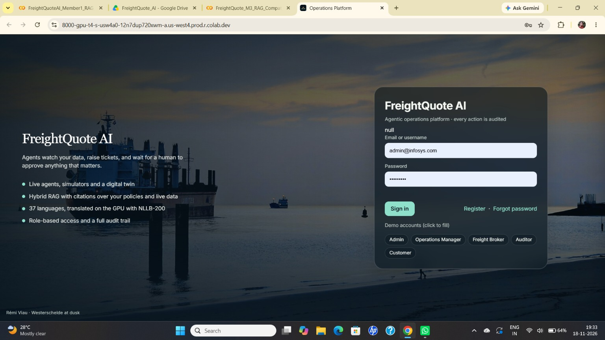

#### 02. Final login screenshot

The submitted final login screenshot shows the FreightQuote AI maritime landing design and credential form.

This second final sign-in view shows the appearance of the authentication screen used in the integrated application.


#### 03. Operations manager copilot

An Operations Manager is signed in on the AI Copilot screen. The broader navigation includes approvals and operational agents; this role is intended to inspect agent findings and manage operational decisions.

Operations Managers need visibility into decisions, approvals and active operations; the sidebar reflects that wider responsibility.

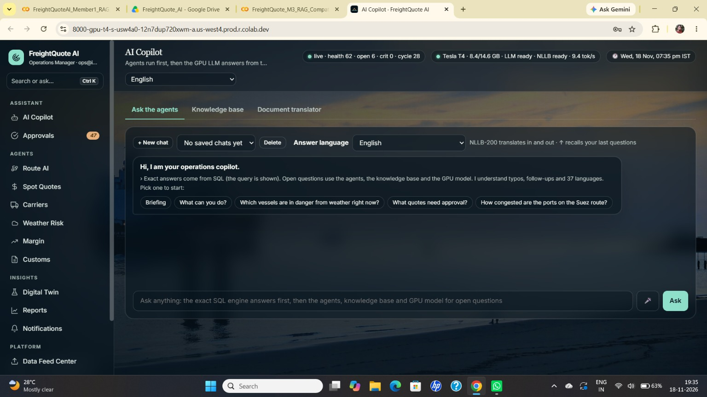

#### 04. Freight broker copilot

The Freight Broker role is visible with its operational sidebar. The Copilot offers suggested logistics questions and indicates that SQL, agents, the knowledge base and the GPU model can contribute to answers.

The broker-facing workspace connects Copilot assistance to practical freight quote work.


#### 05. Final freight broker view

The final Freight Broker screenshot documents the Copilot and role-specific sidebar in the latest running demonstration.

This later Freight Broker capture provides another view of the role-specific navigation in the integrated release.

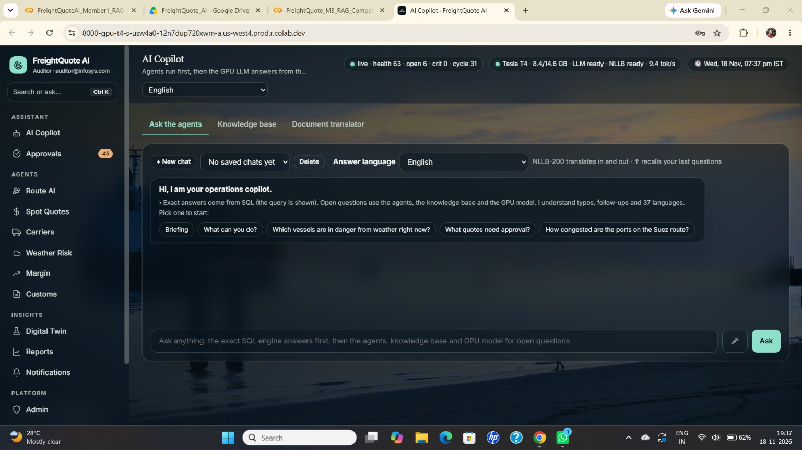

#### 06. Auditor copilot

The Auditor view shows the role identity and the Copilot workspace. It helps demonstrate role-dependent navigation; read-only enforcement must still be tested with protected API requests.

The Auditor perspective makes it possible to inspect operational context without presenting the same navigation as an operations account.


#### 07. Final auditor view

The final Auditor screenshot documents a separate login role and sidebar access; protected read-only API behavior must be confirmed independently.

This final Auditor screen reinforces the differences in account-level navigation.


#### 08. Customer copilot

The Customer account shows a reduced navigation menu while retaining access to relevant quote functions and the Copilot. This illustrates the intended least-privilege experience.

Customer navigation is deliberately narrower, keeping the focus on the customer-facing experience.

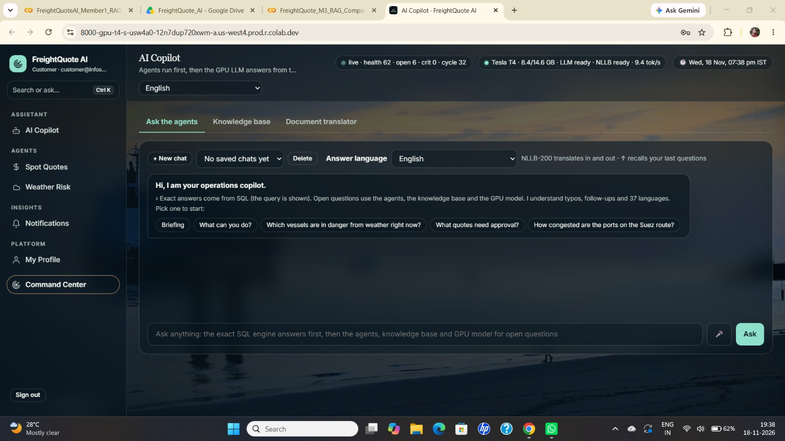

#### 09. Admin profile example

An Admin profile shows identity, role, joined/last-login fields, and preference controls. The screen demonstrates user-facing profile information and personal settings.

The Admin profile connects role identity with account preferences and saved profile details.

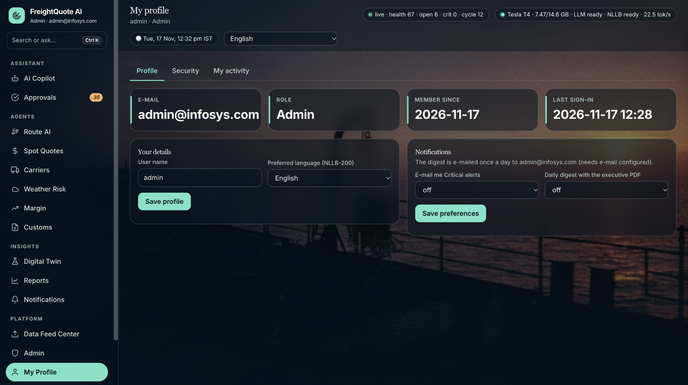

#### 10. Admin user profile

The Admin profile identifies the privileged account and exposes account settings, complementing the role-specific navigation.

This alternate admin account view complements the profile screen with a second example from the running app.

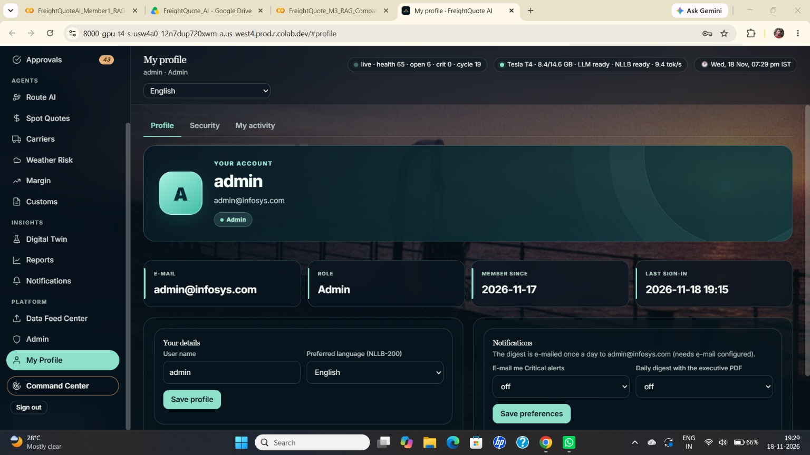

#### 11. Profile security settings

The Security tab contains a password change form. This is a UI-level view of account security management.

The security settings are part of day-to-day account maintenance, not a separate installation workflow.

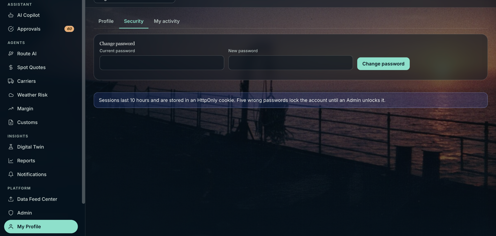

#### 12. Profile activity audit

The My Activity tab displays a log-style list for sign-ins and user actions, supporting transparency for account holders.

My Activity helps account holders review recorded sign-ins and related account actions.

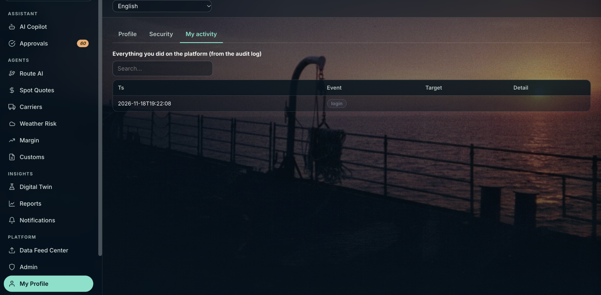

### From a shipment request to an informed quote

A freight request brings together its route, carriers, weather conditions, commercial margin and customs documents before a decision is made.

#### 13. Spot quote request form

The Spot Quotes page shows fields for origin, destination, cargo, weight and shipment details; submitting a request begins the agentic quote workflow.

A new quote begins by describing the shipment; those details are passed into downstream freight calculations and checks.

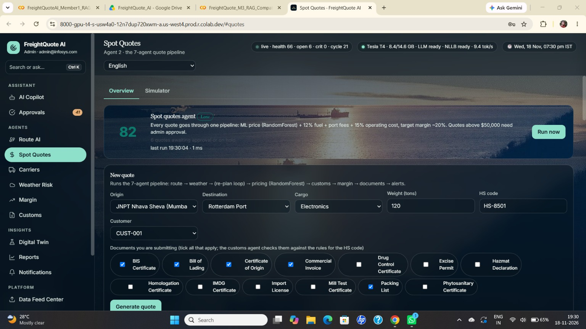

#### 14. Route ai live fleet map

A geographic map shows port/vessel points and high-level fleet metrics. The project reference distinguishes its simulated vessel positions from live Open-Meteo weather.

The fleet map situates vessel and port information geographically, helping operators interpret routes at a glance.

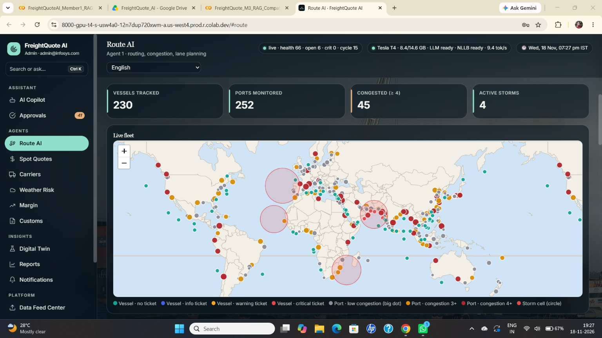

#### 15. Carrier ranking dashboard

The Carriers page includes carrier scores, reliability indicators and performance visualizations, illustrating options for operational carrier selection.

Carrier comparison places reliability and service information beside routing and price considerations.

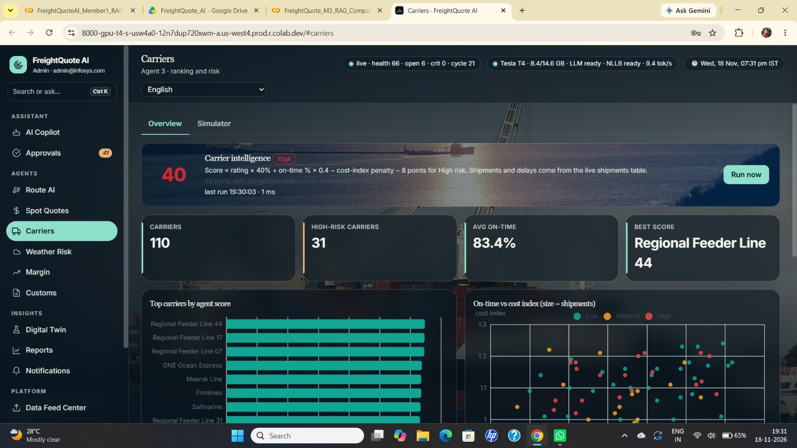

#### 16. Weather risk overview

The Weather Risk page displays observed or derived weather conditions and a map/metrics area. The project uses Open-Meteo weather feeds, unlike simulated AIS/freight records.

Weather conditions matter because they can alter transit expectations, delay estimates and routing decisions.

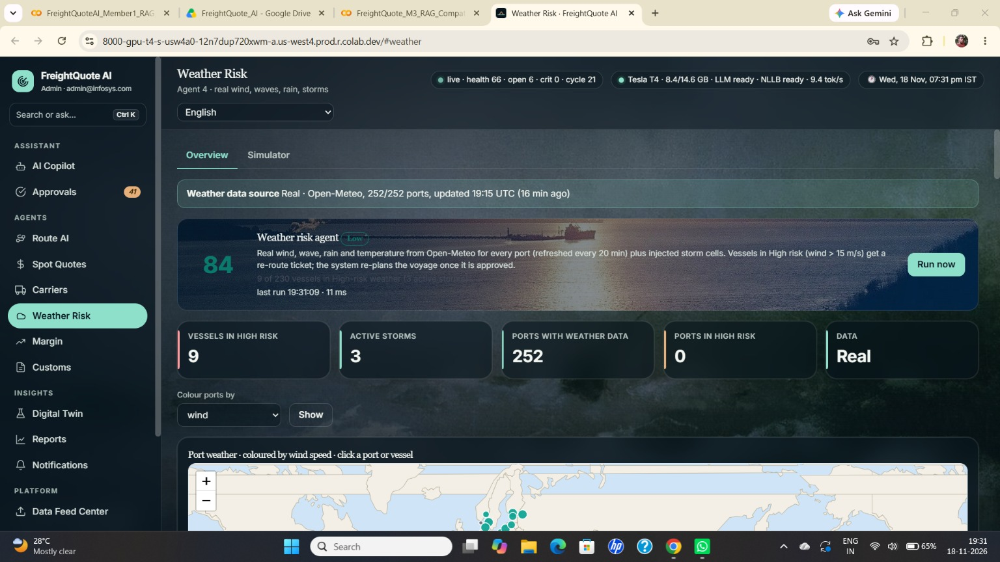

#### 17. Margin and approvals overview

The Margin page summarizes quote economics, approvals and anomalies requiring review.

Margin monitoring adds a commercial checkpoint before a quote is released or approved.

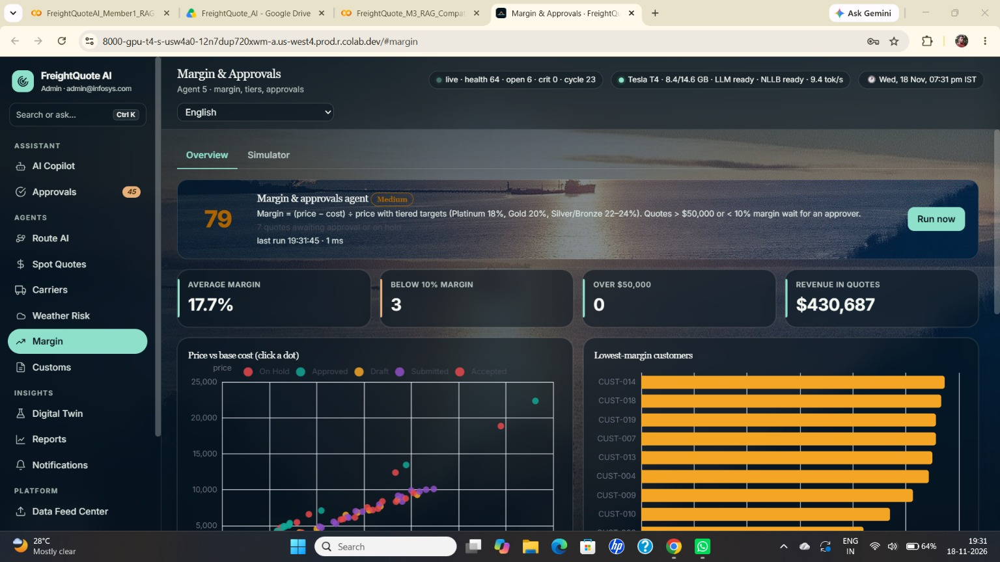

#### 18. Customs overview

The Customs agent page shows pending documentation, holds and current items requiring review.

Customs status and holds highlight why accurate shipment documentation matters for the quote and subsequent movement.

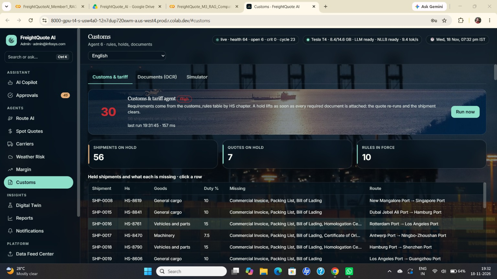

#### 19. Customs document centre

The Customs page shows a document library and upload area for shipping documentation. It connects customs review with evidence and required paperwork.

Document upload and management support customs checks and shipping paperwork.

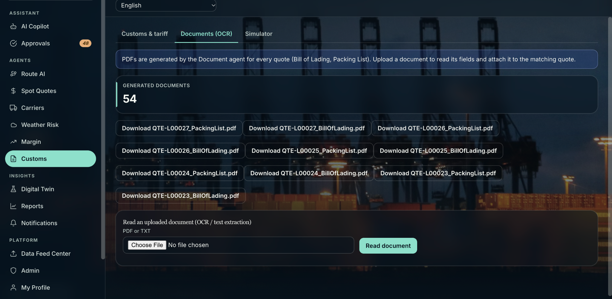

### The AI Copilot, knowledge base and translation

The Copilot provides a conversational entry point. Structured operational questions draw from application data, while domain explanations can use the indexed freight knowledge base and multilingual tools.

#### 20. Copilot question and response

The AI Copilot displays a user question with a response. It demonstrates conversational interaction; answer grounding is evaluated by inspecting source and SQL trace indicators.

The visible exchange demonstrates how a user interacts with the Copilot within the freight application.

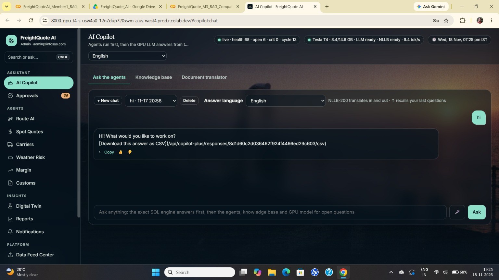

#### 21. Rag knowledge base tab

The Copilot knowledge-base page displays document ingestion/search controls, knowledge source management, and retrieval functionality. The screen alone does not certify corpus size or successful citation tests.

This is where freight references can be added, searched and used to support answers beyond database values.

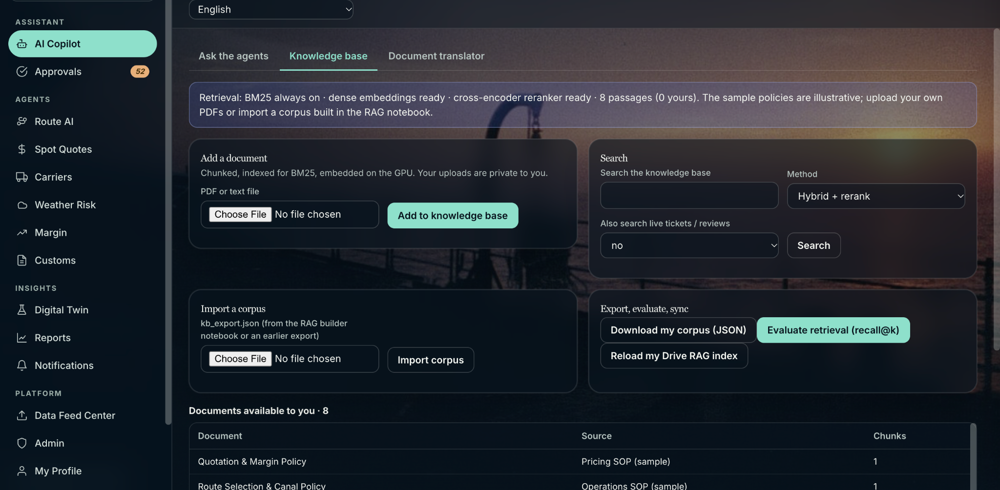

#### 22. Document translation tab

The Copilot document translator provides a file upload and language selection flow. NLLB-based translation is the intended backend; evaluate translations using a real document to verify outputs.

The translator extends access to freight documents across languages, using the integrated language workflow.

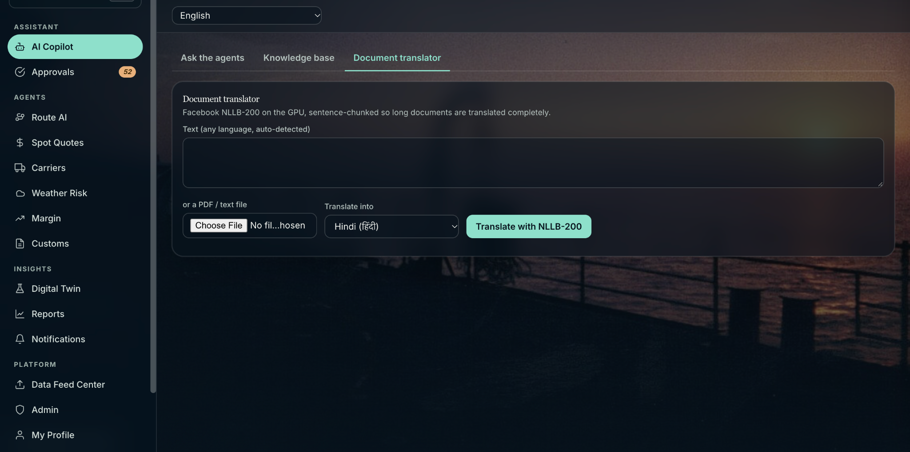

### Approvals and human oversight

High-impact decisions are brought into an explicit approval process, with assigned responsibility, recorded decisions and policies for how much autonomy each action receives.

#### 23. Approvals dashboard

The Approvals page shows pending counts, open approvals, and active request cards. It illustrates the human-in-the-loop workflow where agents propose actions but users authorize risky changes.

The approval queue is the hand-off between agent recommendations and human decisions.

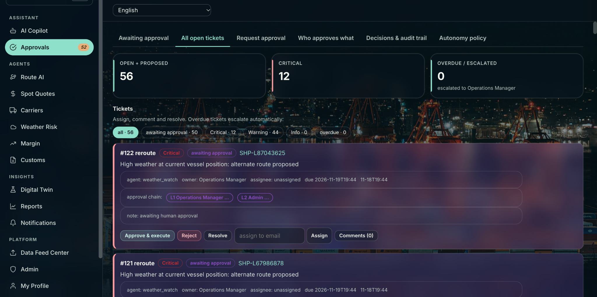

#### 24. Approvals under operations manager

An Operations Manager view shows operational approval cards and totals. It is evidence of the approval dashboard in the running UI.

Seeing approvals from the Operations Manager account connects the approval queue to a specific authorized role.

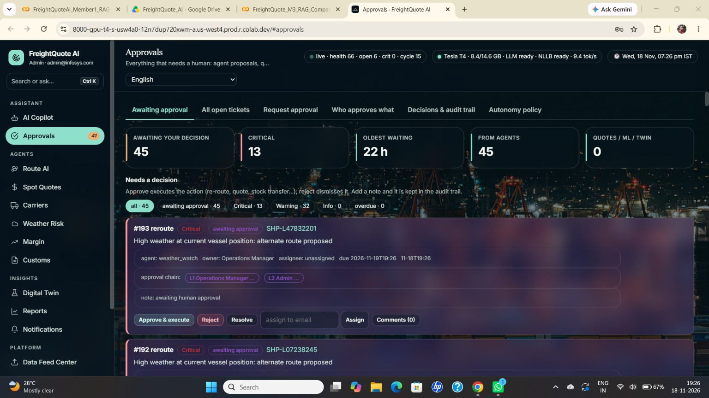

#### 25. Request approval form

A form allows staff to request an approval and provide justification, priority, and type. It is used for manually initiated governance decisions.

A human can also initiate a structured approval request rather than waiting for an agent to raise one.

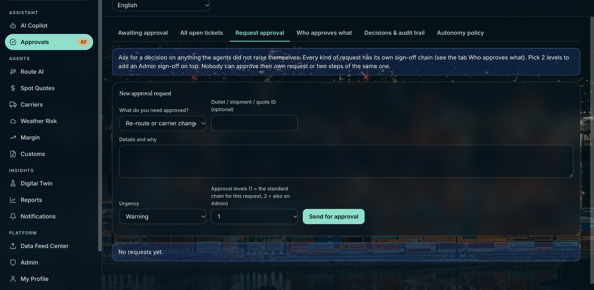

#### 26. Approvals who approves what

The approval-routing tab summarizes action types and the responsible roles, making the intended approval policy understandable to operators.

The approver matrix provides clarity about which role is responsible for each kind of action.

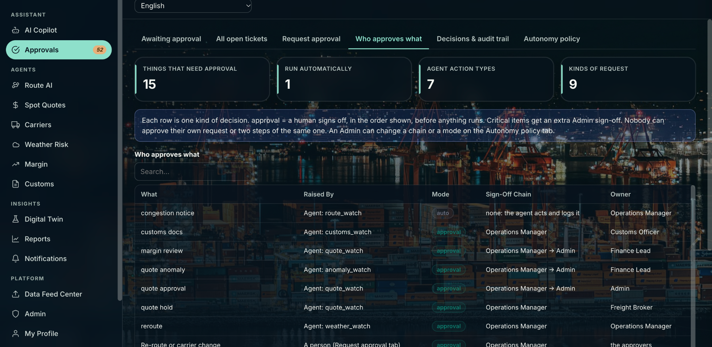

#### 27. Decisions and audit trail

A decisions and audit section records approval activity or decisions. This screen shows the interface for traceability, not a substitute for actual audit-log integrity testing.

Decision history contributes traceability after a request has been approved or rejected.

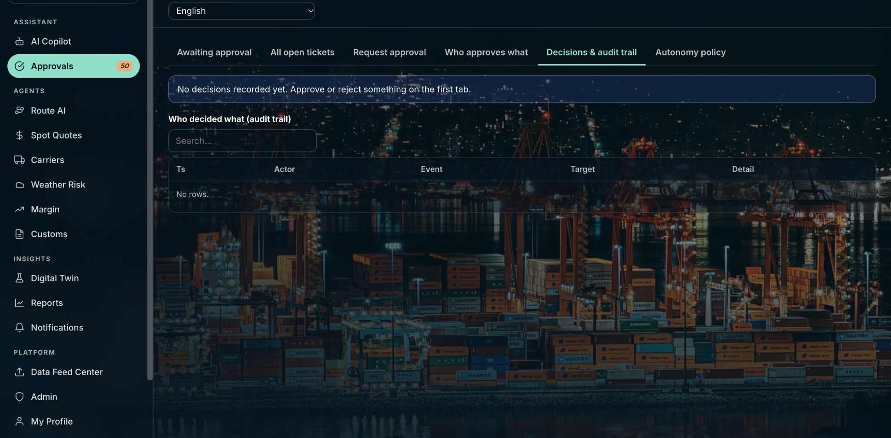

#### 28. Autonomy policy configuration

The policy tab shows action categories, auto/approval modes, and ordered approver chains. It is the principal interface for governing autonomous agent actions.

Autonomy policies determine whether an action can proceed automatically or must pass through review.

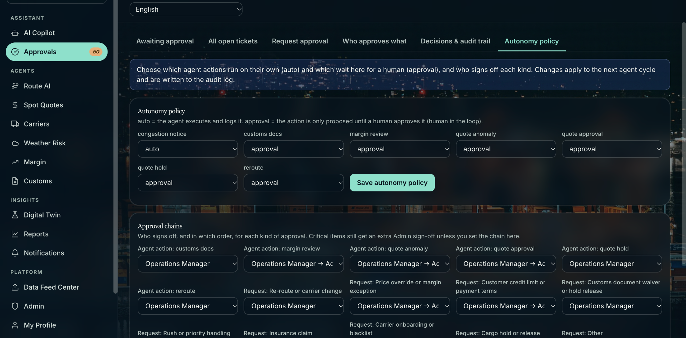

### Testing alternatives with simulators

The simulator pages let operators explore changing routes, rates, carrier conditions, storms, margins and customs delays without treating every hypothetical outcome as a live operational change.

#### 29. Route simulator

The Route AI simulator exposes disruption inputs such as a closure and price changes. Its purpose is to compare feasible route alternatives, costs and expected transit times without changing live freight records.

Route disruption scenarios let an operator compare alternatives when a canal or lane changes.

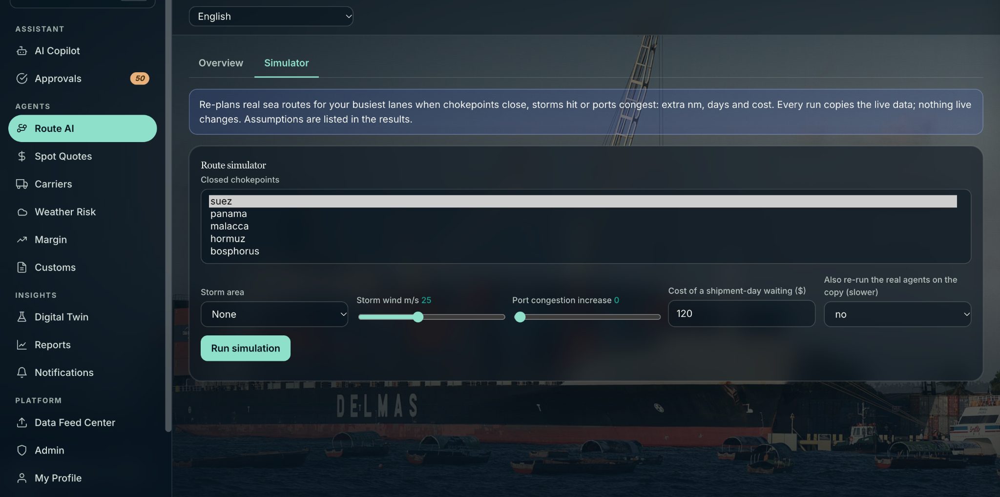

#### 30. Quote simulator

The Spot Quotes simulator varies quote economics (including margin and fuel) to estimate prices and commercial impacts under different scenarios.

Quote what-if inputs illustrate the sensitivity of price to costs and commercial assumptions.

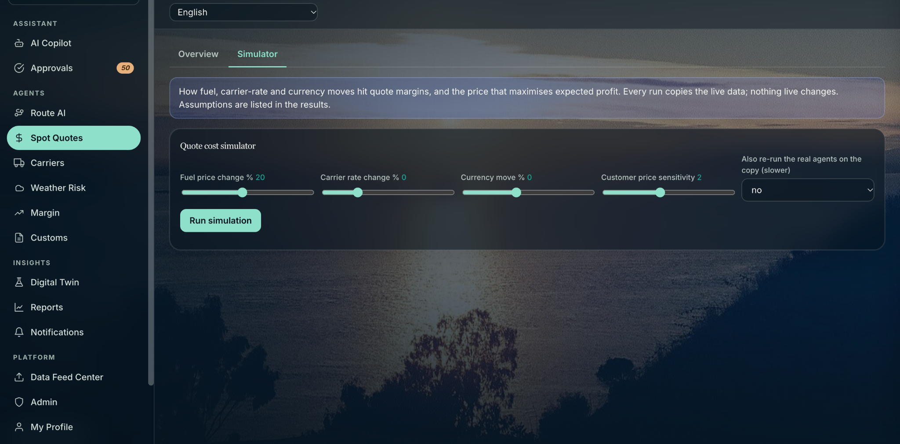

#### 31. Carrier simulator

The carrier simulation interface models availability and reliability disruptions, so carrier rankings can be compared under capacity constraints.

Carrier simulations explore performance or capacity changes before recommending a provider.

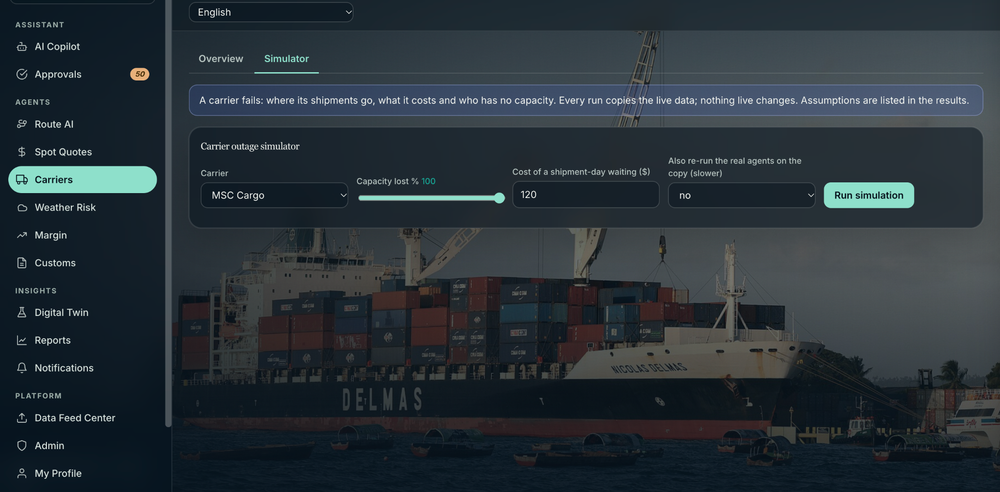

#### 32. Weather simulator

The weather simulation screen exposes storm intensity/duration and delay-related controls. Intended outputs include delay estimates and demurrage implications.

Weather simulations focus on the operational cost of stronger or longer disruptions.

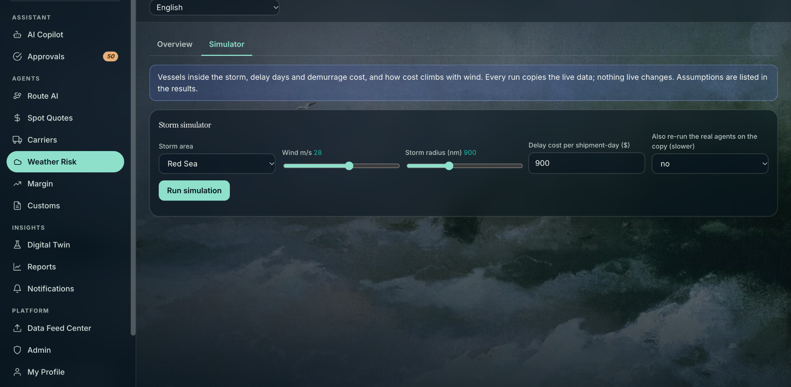

#### 33. Margin simulator

A pricing/margin scenario screen shows the margin-sensitive quote logic. This is one of the practical decision support tools that complement agents and approvals.

The margin simulator investigates whether changes in cost or price leave an acceptable commercial outcome.

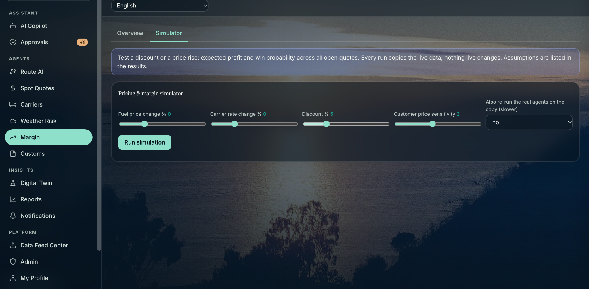

#### 34. Customs simulator

The Customs simulation tab models inspection rates, missing documents and costs of holding cargo. It is a what-if tool, not a direct edit to a live shipment.

Customs simulations translate documentation or inspection delays into potential holding time and cost.

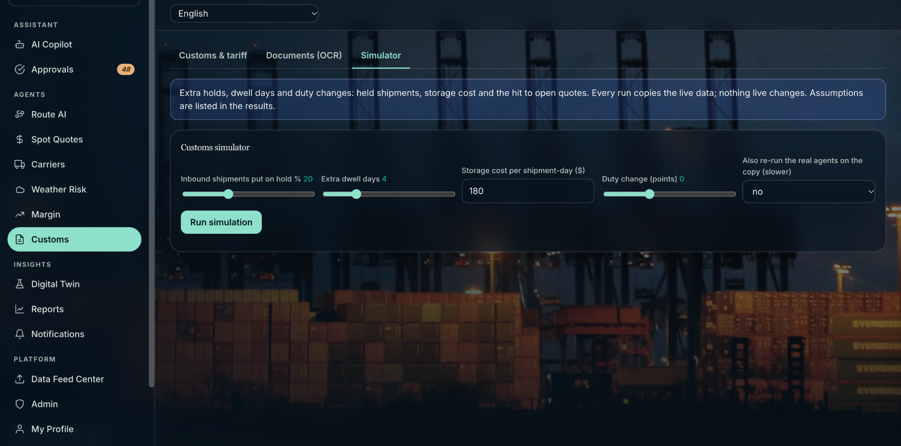

### Digital Twin and operational intelligence

The Digital Twin and Command Center connect what-if analysis to continuous operational visibility, anomalies and relationships between key freight entities.

#### 35. Digital twin scenario lab

The Digital Twin form exposes numeric controls for disruption scenarios. The scenario is a private what-if model, designed not to mutate production records.

The scenario lab presents the assumptions a user adjusts before calculating a what-if outcome.

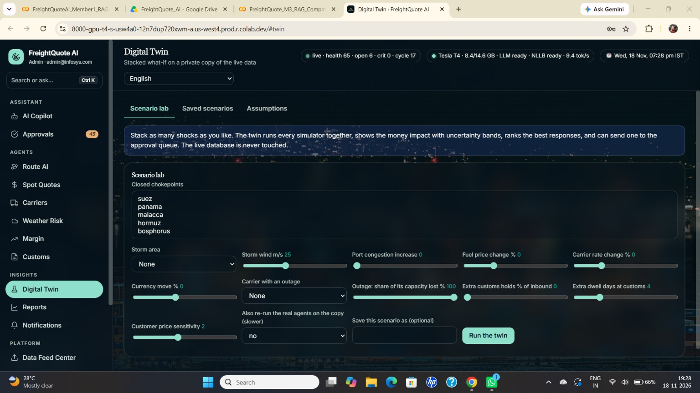

#### 36. Digital twin scenario results

The Digital Twin screen displays explanatory outputs from scenario calculations for route, quote, carrier, weather, and customs changes.

The scenario results connect those inputs to projected outcomes and possible mitigation choices.

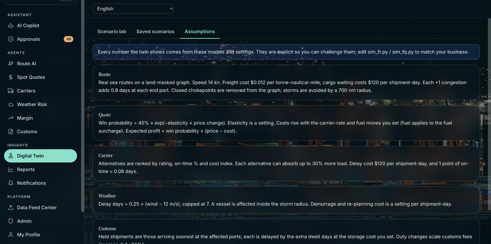

#### 37. Command center agent timelines

The Command Center Agents view shows monitoring events, a timeline and health-trend visualizations for automated watchers.

Agent timelines help explain what the monitoring system checked and how operational health has moved.

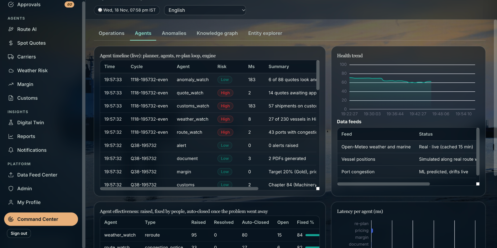

#### 38. Command center anomaly detection

The Anomalies tab presents an IsolationForest-based anomaly overview and scatterplot to identify unusual pricing or shipment metrics.

The anomaly view is intended to surface unusual patterns that deserve investigation rather than immediate automated action.

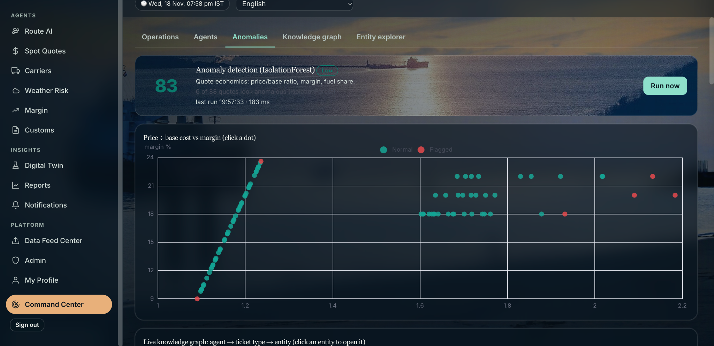

#### 39. Command center knowledge graph

The Knowledge Graph screen visualizes entities and relationships so operators can trace ports, shipments, and associated operational concepts.

The knowledge graph shows the linked entities behind operational records in a visual form.

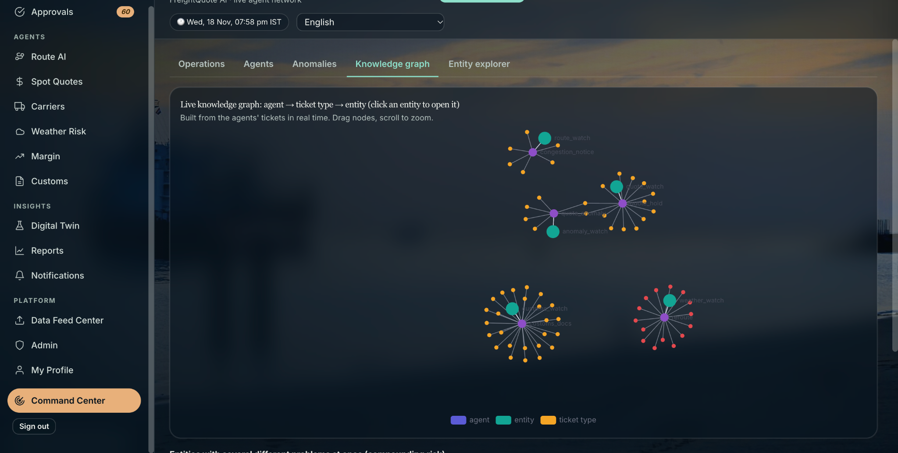

#### 40. Command center entity explorer

The entity explorer displays a selected port and its graph relationships, supporting drill-down from the broader knowledge graph.

An entity-specific explorer makes those relationships easier to inspect for a selected port or other item.

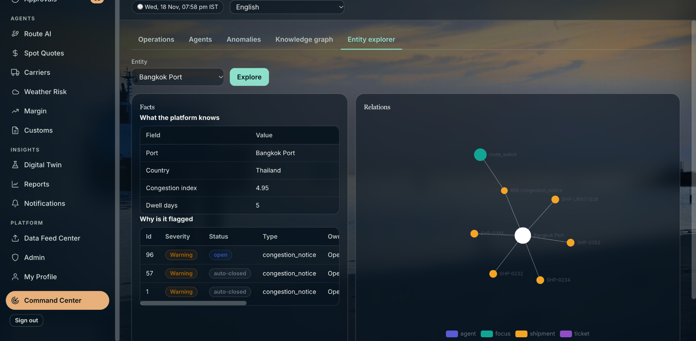

### Reports, notifications and data quality

Reporting turns operational results into shareable outputs; notification and feed-management screens address how outside information enters the system and how the team monitors its quality.

#### 41. Reports export centre

The Reports area offers exportable reports and operational documents. These outputs help stakeholders audit, share and communicate freight performance.

Export tools turn operational information into documented reports for internal review.

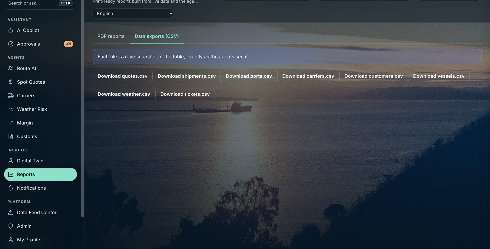

#### 42. Reports as pdf downloads

The Reports page shows multiple download controls for management and operational reporting.

The report-download view demonstrates the PDF outputs available from the interface.

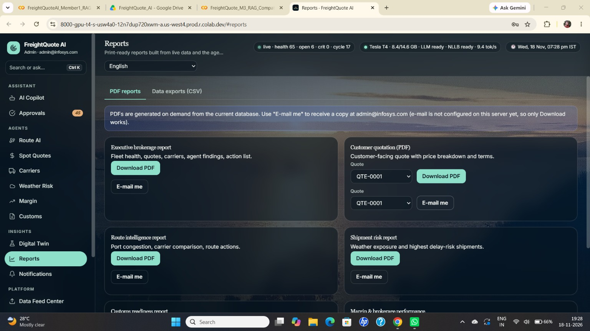

#### 43. Notification channels

The Notifications area lists possible outbound channels and their environment configuration. A configured channel must be tested separately before claiming notifications are delivered.

Notifications are the channel through which the system can communicate relevant events beyond an on-screen dashboard.

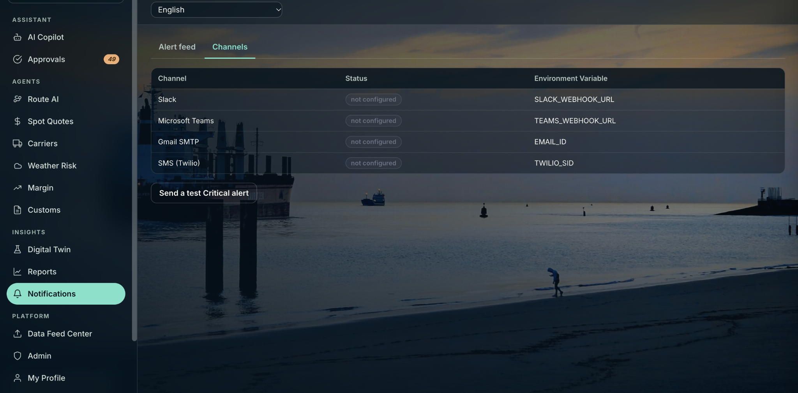

#### 44. Data feed center live api

The Data Feed Center describes inbound feed options and endpoint-based ingestion. It shows how external vessel or freight data can replace the demonstration dataset.

The live API feed view describes one way the application accepts external operational data.

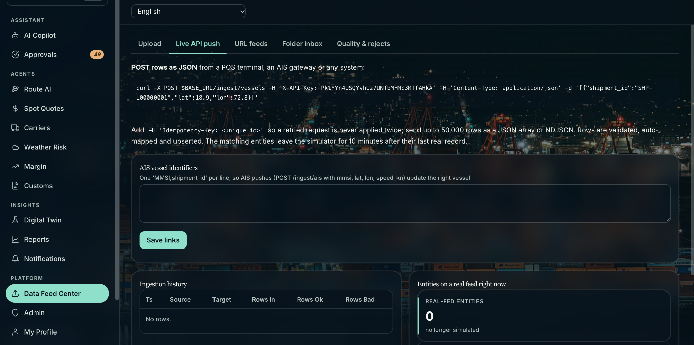

#### 45. Data feed center url feeds

The URL feed registration tab contains form fields for managing external data feeds. Data must pass validation before ingestion.

Registered URL feeds support recurring ingestion from selected external sources.

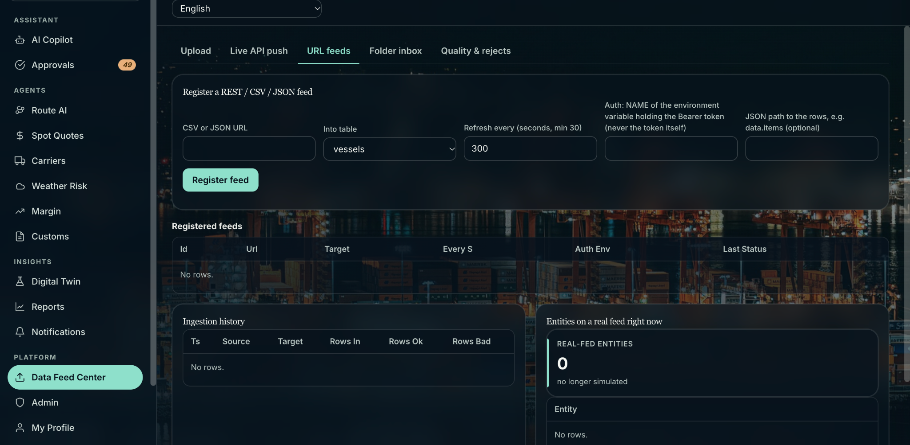

#### 46. Data feed center feed history

The folder/feed view displays ingestion metadata and registered sources. It provides a way to inspect imported input sources.

Feed history gives operators a place to inspect ingestion records and source activity.

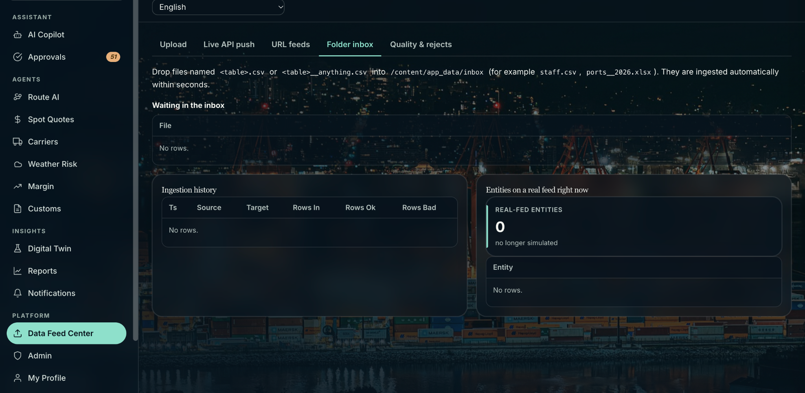

#### 47. Data feed center quality and rejects

The Quality & Rejects tab shows accepted and rejected-row statistics. Empty counters demonstrate the present screen state, not that live ingestion was tested.

Quality and rejects distinguish accepted records from input data that should be quarantined or corrected.

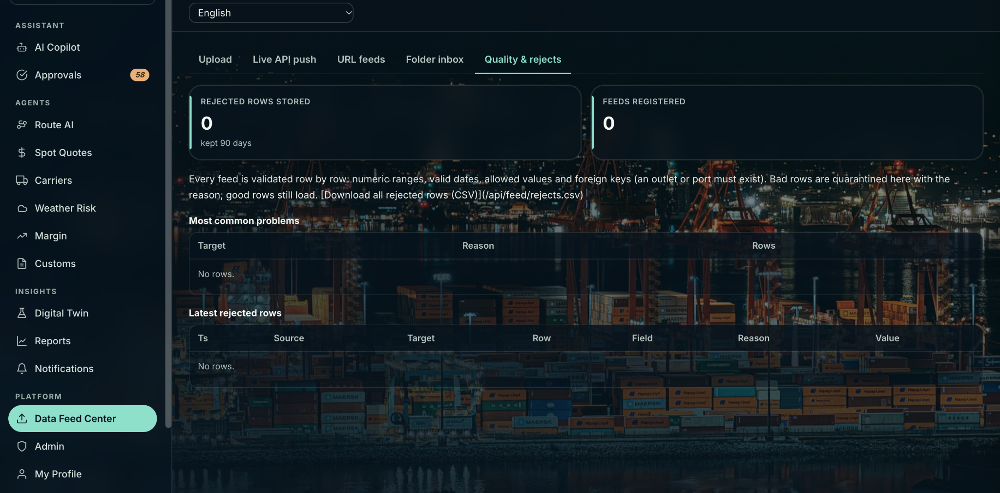

## What this release demonstrates

FreightQuote AI shows how a freight platform can coordinate specialized machine-learning and rule-based components without removing people from consequential decisions. A quote moves through routing, weather, pricing, customs and margin checks; a monitoring loop watches for changes; the Copilot makes data and freight knowledge easier to access; and the approval trail records responsibility for actions.

The project is a demonstrator rather than a production maritime tracking service. Weather may be obtained from a live source, while vessel positions, shipment records and some prices are simulated unless external feeds have been connected. Mail and notification integrations require their own credentials. The RAG index, language models and operational database depend on the Colab/Drive runtime configuration. For these reasons, reported source counts, training accuracy and simulator results should come from the actual run rather than assumptions based on the interface.

Together, the application notebook, RAG builder, 47 annotated screenshots and six-slide presentation document the work completed for the final milestone.
